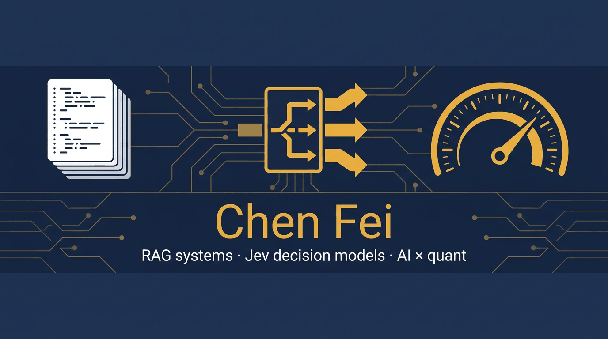

  

### Chen Fei (@vicfei)

I build retrieval-augmented systems, and lately most of my time goes to the **Jev / TypeSafe ecosystem** — decision models that answer typed questions with calibrated probabilities instead of generating text. Rank #17 contributor to [WeKnora](https://github.com/Tencent/WeKnora), Tencent's open-source LLM knowledge platform (30k+ stars).

## Featured projects

  
  

- **[awesome-jev-prompts](https://github.com/vicfei/awesome-jev-prompts)** — question patterns, anti-patterns & calibration notes for typed decisions. 63 patterns / 10 categories, bilingual, an Engine Cookbook that runs one question across five engines, a live leaderboard of the 59 ecosystem projects, and a stdlib-only question linter. 
- **[dsh-super-agent](https://github.com/vicfei/dsh-super-agent)** — admission control, observe mode & tickets for **any CLI coding agent**: the independent, executor-agnostic implementation of the DeepSeek Super-agent authorization design (admission tables, explicit/inferred strength, off → observe → auto progressive trust). Works with `claude` / `codex` / `opencode` / `aider` / anything. 

**The rest of the Jev loop** — the pattern library supplies the questions, the benchmark measures them, the skill chains them into a workflow:

- [jev-rag-zh-benchmark](https://github.com/vicfei/jev-rag-zh-benchmark) — reproducible Chinese reranking benchmark: Jev Score nDCG@5 0.546 vs BM25 0.413 on T2Reranking hard negatives, pinned model versions, full logs — [DOI 10.5281/zenodo.23322277](https://doi.org/10.5281/zenodo.23322277), mirrors on HF & ModelScope
- [jev-pipeline-skill](https://github.com/vicfei/jev-pipeline-skill) — one workflow for question design: find → fit → draft → lint → spread → threshold → cascade; installs as an agent skill on five channels
- [minimind-jev](https://github.com/vicfei/minimind-jev) — a from-scratch tiny decision model with a full Chinese tutorial (open the box, not chase SOTA). First checkpoint out: [cnfeichen/minimind-jev-v0.1](https://huggingface.co/cnfeichen/minimind-jev-v0.1); the v0.2 distillation arc is a documented negative result, teacher judgments [released as a dataset](https://huggingface.co/datasets/cnfeichen/t2reranking-4level-judgments)
- [awesome-ai-quant](https://github.com/vicfei/awesome-ai-quant) — the bridge from AI engineering to quantitative finance: trading agents, factor discovery, decision models × finance

## Selected work

- [Awesome RAG Frontier](https://github.com/vicfei/Awesome-RAG-Frontier) — rule-based, machine-refreshed tracker of RAG papers, projects & waves; it caught the decision-layer wave before any other list
- [WeKnora](https://github.com/Tencent/WeKnora) — contributor, rank #17
- [deer-flow](https://github.com/bytedance/deer-flow) · [Octop](https://github.com/TencentCloud/Octop) — contributor

Focus areas: RAG in production, knowledge platforms, decision-layer models (Jev / TypeSafe ecosystem), agentic retrieval, question design & calibration — and, newly, AI × quantitative finance.

  
  

---

中文：RAG 与知识库的工程落地，[WeKnora](https://github.com/Tencent/WeKnora) 贡献者（第 17 位）。主线在 Jev 决策模型生态：[问题模式库](https://github.com/vicfei/awesome-jev-prompts)（63 条双语 + 引擎手册 + 生态排行榜）→ [中文重排基准](https://github.com/vicfei/jev-rag-zh-benchmark)（带 Zenodo DOI）→ [问题设计流水线技能](https://github.com/vicfei/jev-pipeline-skill) → [minimind-jev](https://github.com/vicfei/minimind-jev)（从零训练小决策模型 + 中文教程）。新开两条线：[dsh-super-agent](https://github.com/vicfei/dsh-super-agent)（DeepSeek Super-agent 准入控制的独立实现，任意 CLI 编码智能体可用）与 [awesome-ai-quant](https://github.com/vicfei/awesome-ai-quant)（AI × 量化资源地图）。
